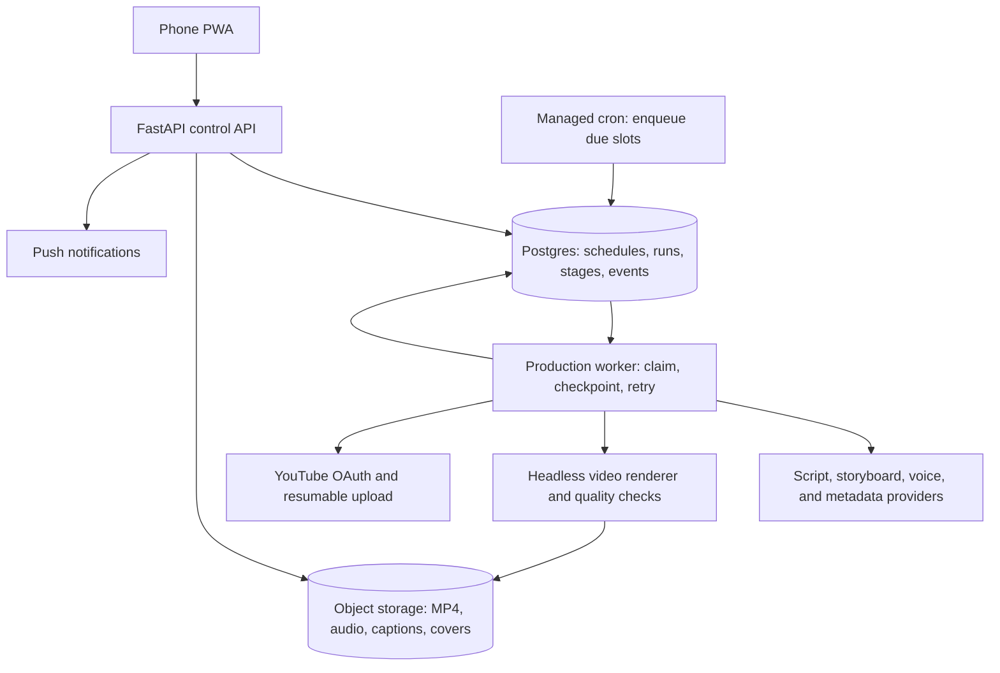

# Cloud YouTube automation and mobile cockpit roadmap

Implementation update: the first automation, rendering, provider, and mobile workflows have now
been added. See [ZERO_COST_DEPLOYMENT.md](ZERO_COST_DEPLOYMENT.md) for the current implemented
architecture and setup. The audit below records the original baseline and proposed broader work.

Review date: November 21, 2026.

## Objective and priority

Primary objective: create and upload 1–3 quality YouTube videos each day, entirely in the cloud, with progress, previews, publishing controls, and failure alerts accessible from a phone. Routine operation must continue when the development computer is off and the phone app is closed.

Secondary objective: build feature parity with the intended Codex mobile experience. Track this against a dated feature checklist and a visual reference, with acceptance tests for each workflow. A similar chat screen alone does not establish parity.

This is a source audit and implementation proposal. The automation described below has not been implemented or deployed by this review.

## Projects inspected

| Project | Verified purpose | Role in the proposed system |
| --- | --- | --- |
| `ggwp` | React/TypeScript PWA; FastAPI; SQLAlchemy; cloud coding/chat agent using E2B; task events; approvals; connector configuration | Main application, phone control, API, task history, and agent workspace |
| Sibling folder `roblox` | Storm Rescue game prototype with Luau gameplay and tools for a connected local Roblox Studio session | Optional future source of gameplay; an automated recording workflow still needs to be built |
| Sibling folder `cliping` | Python/OpenGL animated-story renderer, speech/audio assembly, captions, MP4 generation, and media validation | Most directly reusable video-production foundation, if animated stories are the desired format |

The supplied path ending in `roblox poroject` was not found. `roblox` was inspected as the likely intended folder. `cliping` was identified nearby and reviewed because it contains the existing video pipeline. Confirm the intended content format before adapting either project.

The `cliping/output/short/validation.json` report records a 41.367-second, 1080 × 1920, 30 FPS video with 20 shots, a successful full decode, and a file size of 19,873,488 bytes. These are existing report values, not a new render or a cloud benchmark.

## Existing application capabilities and gaps

| Capability | Current evidence | Work needed |
| --- | --- | --- |
| Phone interface | Installable PWA configuration and mobile navigation in `pwa/vite.config.ts` and `pwa/src/components/BottomNav.tsx` | Add automation overview, series configuration, video preview, and run history |
| Coding and general chat | Projects, chats, model selection, tool execution, E2B sandboxes | Preserve these workflows while adding video-specific jobs |
| Live monitoring | Persisted events and SSE; stop/steer; screenshots and file previews | Video stages, upload progress, durable cross-process controls, and reconnection validation |
| Approvals | Database approval records and phone actions | Persist review state without holding a worker or runtime timer open |
| Code review | Changed-file summary from `git diff --stat` | Persist actual patch hunks and check results; allow review after sandbox expiry |
| Connectors | GitHub, Gmail, Slack, Notion handlers and encrypted configuration | Add a channel-specific YouTube OAuth integration; Calendar/Drive is currently a placeholder |
| Background notifications | Web Push subscription and backend send code | Complete and verify service-worker push display, notification tap routing, and device unsubscribe |
| Daily production | Tasks are started on demand | Durable timezone-aware schedules, reserved daily slots, retries, and missed-run policy |
| Video generation | Exists separately in `cliping` | Generalize story inputs and package/test a headless Linux renderer |
| YouTube uploads | No implementation found | Consent, token refresh, resumable uploads, processing checks, publishing, and reconciliation |
| Media storage | Generic artifacts are database blobs; preview tool caps files at 8 MiB | Object storage and authenticated or short-lived signed playback URLs with seeking |
| Cloud deployment | `render.yaml` defines a free web service and static PWA | Reliable worker/scheduler hosting, durable Postgres, object storage, and deployment checks |

The GitHub Actions cron in `.github/workflows/keepalive.yml` calls health checks. It does not schedule video production.

## Reliability findings to address first

1. **Recover queued work as well as running work.** `backend/app/worker.py` keeps its execution queue in memory. Startup recovery selects `running` and `awaiting_approval`, but omits `queued`. A crash between committing a task and enqueueing it can strand the task.
2. **Reclaim leases continuously.** A task whose lease cannot be acquired is dropped from the in-memory queue without an automatic retry. Add periodic database polling, lease renewal, and safe reclamation of expired leases.
3. **Own the complete worker lifecycle.** The agent loop is launched as a separate asyncio task. Verify shutdown cancels and awaits that child before releasing ownership, so an old worker cannot keep making side effects while a replacement starts.
4. **Persist stop, steer, and review decisions.** Several delivery mechanisms are process-local. API and workers must communicate through durable state when split into separate services.
5. **Use stage checkpoints.** Agent history is saved after a run in the inspected loop; the architecture document's per-iteration checkpoint claim is stronger than the implementation. Video jobs need explicit, persisted stage inputs and outputs.
6. **Separate execution time from waiting.** The configured default task runtime is 1,800 seconds and the default global active-task cap is one. A video waiting for review should release its execution slot. Give render and upload stages their own bounded timeouts.
7. **Check credential serialization.** Connector masking uses key-name heuristics, and decryption errors become empty configuration. Before storing channel tokens, use explicit public response schemas, report reconnection requirements clearly, and keep credentials out of prompts, artifacts, logs, and API responses.
8. **Verify the actual production data path.** Use durable Postgres and test migrations on a fresh and upgraded database. The current health endpoint alone does not establish database, scheduler, worker, or renderer readiness.

Render documents that free web services spin down after inactivity, may restart, and lose local filesystem changes on restart/redeploy/spin-down. Its free-tier guidance advises against production use. The existing keepalive workflow does not supply durable execution or storage. [R1]

## Proposed architecture

For this volume, a Postgres-backed durable job table and supervised worker are sufficient initial building blocks; a separate Redis queue is optional. The cron command should enqueue due slots and exit quickly. Rendering belongs in the production worker, with a dedicated render container or job when needed, rather than inside an HTTP request.

Keep API and worker deployable separately from the same versioned application. Continue using E2B for coding tasks; determine the rendering runtime from an actual Linux render test. Avoid coupling video production to an LLM repeatedly writing and executing arbitrary renderer code.

Package the renderer as versioned source with a stable command contract. Do not depend on absolute Desktop paths or copy local caches and generated MP4s into the deployment image.

### Persistent records

| Proposed record | Essential state |
| --- | --- |
| `YouTubeConnection` | Channel identity, granted scopes, encrypted credentials, expiry/reconnection status |
| `VideoSeries` | Content brief, language, audience, format, voice, brand assets, reference examples, budget, publishing mode |
| `VideoSchedule` | Series, IANA timezone, 1–3 local daily slots, enabled flag, next due time, missed-slot policy |
| `VideoRun` | Reserved slot, content/version IDs, stage/status, attempts, lease/fencing ownership, costs, error, timestamps |
| `VideoStage` | Input/output references, provider request IDs, attempts, execution time, validation result |
| `MediaObject` | Object key, content hash, MIME type, byte length, duration, dimensions, provenance |
| `YouTubeUpload` | Run/media identity, protected resumable-session URI, acknowledged offset, video ID, processing/publishing state |

Use separate video records instead of overloading every video state into the existing coding-task status. Link each run to the shared event feed or a corresponding task so monitoring can reuse existing components.

### Scheduling and retry rules

- Reserve each scheduled slot transactionally using a database uniqueness constraint, such as `(schedule_id, scheduled_for_utc)`. Duplicate scheduler delivery must return the existing run.
- Define daylight-saving behavior explicitly: handle nonexistent/repeated local times and enforce the daily cap in the configured timezone.
- Default missed slots to visible skips rather than publishing a burst after a long outage. A bounded catch-up policy can be selected per series.
- Claim work atomically, heartbeat leases, and fence stale workers from advancing stages or initiating publishing actions.
- Checkpoint artifacts and provider request IDs before advancing. Resume from the last completed stage instead of regenerating everything.
- Retry transient failures with bounded backoff and jitter. Pause for expired authorization, budget exhaustion, permanent upload errors, or failed quality checks.
- Treat uploads as external side effects. Scheduler deduplication alone does not make a YouTube upload exactly once. Persist and query the resumable session, store the returned video ID, and reconcile uncertain outcomes before starting another upload. Hold an ambiguous expired session for investigation rather than blindly inserting another video. [Y3]

## Video production and quality

Provisional format for the first implementation: an original vertical animated story using the reusable parts of `cliping`. This assumption needs confirmation; actual Roblox gameplay requires a different capture system.

Production stages:

1. Choose a distinct concept from the series brief and recent publishing history.
2. Generate and critique a script for hook, narrative logic, pacing, originality, and audience fit.
3. Produce a validated storyboard using the renderer's supported scene/action vocabulary.
4. Generate narration and word timings; assemble licensed/original music and effects.
5. Render scenes, captions, cover artwork, and final MP4.
6. Validate media and review sampled frames, caption placement, audio, and story continuity.
7. Create title/description and publishing settings; upload and verify YouTube processing.
8. Publish or schedule publication according to the series mode; persist the outcome and notify the phone.

`cliping` already supplies parts of stages 4–6, but its scene logic and overlays are substantially authored for one story. A new script cannot reliably become a new episode merely by changing narration. Introduce a typed scene manifest and several genuinely different scene/story possibilities before daily generation.

Cloud portability work includes configurable fonts, a verified headless OpenGL context, packaged FFmpeg dependencies, unique run directories, and a supported narration provider with predictable failure handling. `graphics.py` currently references Windows fonts and creates an OpenGL 3.3 standalone context. The installed-voice fallback invokes PowerShell/System.Speech. None of this establishes tested Linux cloud rendering.

Quality acceptance should cover playable full decode, requested dimensions/duration/frame rate, intelligible speech, loudness/peak bounds, caption alignment and safe placement, blank/frozen-frame checks, narrative continuity, distinct content, and asset provenance. Passing media checks does not prove that a story is compelling; initial editorial review and later audience feedback are still needed.

YouTube's channel monetization guidance calls for original, authentic substance and identifies generic/repetitive content as a monetization concern. Reusing an engine or recurring cast should still produce materially different stories and viewer value. No automated score guarantees engagement or monetization. [Y4]

## YouTube connection and publishing

Connect the channel through Google's OAuth consent flow. The application needs its Google Cloud OAuth client configuration and the channel owner's authorization, with offline access for unattended token refresh. The user signs in with Google; a Google account password is not an application configuration value. Keep refresh tokens encrypted on the backend and provide disconnect/reconnect controls. [Y1]

Start with the upload scope where sufficient; evaluate additional scopes only for concrete channel, processing, analytics, or metadata operations. Validate granted scopes, OAuth state, allowed redirect URIs, token expiry, and the production consent setup. [Y1, Y2]

Explicitly set upload privacy and store the returned video ID. Support resumable uploading and retry classification. The API exposes publishing, audience, and synthetic-media metadata fields; choose accurate values from the actual content and channel setup rather than assuming every animation has the same audience/disclosure settings. Check the project's current quota and account publishing eligibility during setup instead of embedding remembered quota numbers. [Y2, Y3]

Commissioning mode can upload privately for validation and phone review. The required final operating mode is automatic publishing at configured slots after quality and budget checks pass. Per-video manual approval is an optional series mode, not a permanent requirement for the user's unattended workflow.

## Mobile feature parity workstream

OpenAI's mobile documentation checked on the review date describes choosing Cloud or a connected computer/project, starting and continuing tasks, following progress, steering work, approvals, and inspecting changed files, diffs, and test results. Its cloud documentation describes tasks that continue while the user's computer is asleep. Use these documented behaviors as the first parity baseline. [O1, O2]

| Workflow | Current `ggwp` position | Acceptance target |
| --- | --- | --- |
| Projects, conversations, task creation | Present | Consistent mobile navigation, task search/history, and resumable conversations |
| Cloud execution | E2B and worker present | Durable runs continue through app closure, API restart, and worker replacement |
| Progress and steering | Present, delivery partly in memory | Ordered reconnectable activity and durable stop/steer acknowledgments |
| Approvals and permissions | Present | Clear policy, persistent decisions, and reliable notification/deep links |
| Changed files, diffs, check results | Partial | Full patch hunks, test evidence, persistent review, and follow-up instructions |
| Git/PR workflow | Agent tools and PR links present | Inspect changes and checks before explicit commit/push/PR actions |
| Cloud environments and host selection | Per-task sandbox exists; reusable environment/remote-host control absent | Named cloud setups; implement connected-computer access if included in the target mobile reference |
| Attachments, previews, and notifications | Partial | Image/file/video handling, secure previews, background alerts, and tap routing |
| Identity, settings, and usage | Single-user bearer token; configuration and token counters | Appropriate sessions/device access, model settings, usage/cost view, and reconnection states |
| Scheduled video operations | Absent | Schedule, run now, preview, pause/resume, retry, and publishing history from the phone |

For the requested broader "all features" scope, also inventory voice, browser/computer interaction, agent delegation, memory, skills/plugins, connectors, and any additional workflows visible in the user's target mobile release. The inspected agent already has some browser and connector tools, but that does not establish complete product-level coverage. The subagents used for this audit are review tools, not evidence of a multi-agent orchestration feature inside `ggwp`.

Maintain a dated matrix with supported behavior, visual reference, device coverage, and a passing acceptance scenario per feature. Current public documentation does not supply every layout detail or establish parity with a particular mobile app build.

Suggested automation screens: overview with next slots/channel health, series settings, run timeline with playable draft, and publishing history. Start with the existing PWA so phone access is available throughout implementation; decide on native packaging only if a required device feature needs it.

## Delivery sequence and completion criteria

| Phase | Deliverable | Completion evidence |
| --- | --- | --- |
| 1. Reliable execution | Durable queue/recovery, leases, persisted controls, database readiness, corrected baseline checks | Restart before enqueue, during execution, and during review; each job remains visible and has one active owner |
| 2. Cloud renderer | Versioned renderer, portable assets/fonts, typed scene inputs, object storage, mobile player | Render an existing fixture and a genuinely new short in Linux; inspect both on a phone |
| 3. YouTube publishing | OAuth connect/reconnect, private test upload, session persistence, processing check | Correct channel receives one video; a simulated lost upload response is reconciled without a blind second insert |
| 4. Daily autonomy | Timezone scheduling, 1–3 slots, automatic publishing mode, cost/quality limits, push alerts | Proposed soak test: seven days at one daily slot, then increase to three; observe restart, duplicate-trigger, and provider-failure behavior |
| 5. Mobile parity | Implement remaining features from the agreed dated matrix | Each feature has mobile acceptance evidence, including full diff review and notifications |

Phases 1–4 serve the primary objective. Shared mobile work can proceed alongside them. A full visual/product replica is a separate substantial deliverable and should be tracked explicitly rather than declared complete after the YouTube feature ships.

The first useful implementation slice is one cloud-rendered original video, stored persistently, playable in the PWA, and uploaded privately through a connected channel with restart-safe run history. Scheduling builds on that verified path.

## Validation performed during this review

- Mobile subagent ran `npm run typecheck` in `pwa`: passed.
- Main audit ran `.venv\Scripts\python.exe -B -m unittest discover -s tests` in `backend`: 42 tests, 40 passing, one failure and one error.
- `test_round_trip_preserves_every_table` fails because a SELECT result's `rowcount` is `-1`, which is then asserted positive (`backend/tests/test_backup.py:82–102`).
- `test_binary_and_datetime_values_survive_round_trip` errors when it expects an ORM object from a Core connection's scalar result; the value is a string (`backend/tests/test_backup.py:114–124`). The datetime assertion also needs a meaningful expected value.
- These failures establish defects in the current test assertions; they do not by themselves establish a production backup/restore failure. Correct the assertions and rerun before treating backups as validated.
- Renderer figures above were read from existing reports. No fresh cloud render, deployed-service exercise, or YouTube upload was performed.

The worktree already contained extensive modifications when this review began. This review adds this roadmap; existing application work remains the baseline for subsequent implementation.

## Decisions needed before implementation choices become fixed

1. Content format: original animated stories like `cliping`, captured Roblox gameplay, or another format; Shorts versus longer videos; language and audience.
2. Quality reference: a representative video or written creative brief, and whether occasional fewer uploads is preferable to publishing a weak video. Proposed default: hold failed content and alert rather than fill a quota.
3. Cloud/provider budget: monthly hosting budget and acceptable generation cost per video. Measure actual render/provider usage before quoting an operating cost; daily cadence alone does not determine cost.
4. Schedule: timezone, one to three publishing slots, and commissioning/review versus automatic mode. Proposed start: one daily slot, followed by the intended three-slot maximum after the soak test.
5. Codex mobile reference: intended app/version and feature inventory for visual and functional parity. Broader platform features should be explicitly included in the matrix when expected.

Google OAuth consent and access to the selected cloud deployment will be needed when connecting real services. Account passwords and secrets should be entered through their intended consent/configuration flows.

## Primary sources checked on November 21, 2026

- [Y1] Google, OAuth 2.0 for server-side web apps: `https://developers.google.com/youtube/v3/guides/auth/server-side-web-apps`
- [Y2] YouTube Data API, `videos.insert`: `https://developers.google.com/youtube/v3/docs/videos/insert`
- [Y3] YouTube Data API, resumable upload protocol: `https://developers.google.com/youtube/v3/guides/using_resumable_upload_protocol`
- [Y4] YouTube channel monetization policies: `https://support.google.com/youtube/answer/1311392?hl=en`
- [R1] Render, free-instance behavior and limitations: `https://render.com/docs/free`
- [O1] OpenAI, Codex on mobile: `https://developers.openai.com/codex/mobile.md`
- [O2] OpenAI, Codex Cloud: `https://developers.openai.com/codex/cloud/`
